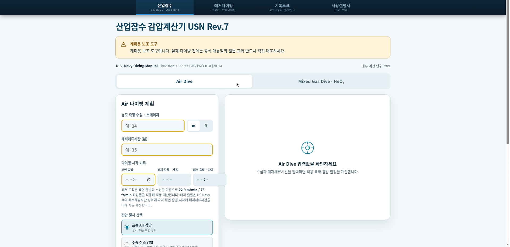

# 미해군 다이빙 매뉴얼 기반 잠수 감압 계산기 (Rev.7A)

상업잠수·레저다이빙·잠수기록도표를 한 페이지에서 계산하는 단일 HTML 웹앱입니다.
U.S. Navy Diving Manual Revision 7 기준표(Table 9-7, 9-8, 9-9, 12-4)를 내장하고, 설치나 회원가입 없이 브라우저에서 바로 실행됩니다.

[](https://moocho-kosoo.github.io/Commercial-diver-decompression-calculator/)




## 바로 실행

- 온라인: <https://moocho-kosoo.github.io/Commercial-diver-decompression-calculator/>
- 오프라인: 저장소의 `index.html`을 내려받아 브라우저로 열면 됩니다. 파일 하나로 동작하며, 인터넷 연결이 없어도 계산 기능은 모두 사용할 수 있습니다.

## 주요 기능

상단 탭으로 네 개의 화면을 오가며, 탭을 바꿔도 입력값은 유지됩니다.

### 1. 산업잠수 감압계산기 (USN Rev.7 · Air / HeO₂)

- 공기(Air) 다이빙과 혼합기체(HeO₂, Surface-supplied) 다이빙 계획을 각각 계산합니다.
- 수심과 해저체류시간을 입력하면 Table 9-9(공기) 또는 Table 12-4(혼합기체) 기준으로 감압 정지 일정을 만듭니다.
- 감압 절차 선택: 표준 Air 감압(공기 호흡 수중 정지), 수중 산소 감압(100% O₂), 표면 산소 감압(SurDO₂).
- 산소 30분마다 5분 Air break를 자동으로 반영하고, 누적 산소 35분 초과 시 30분 후 5분 Air break 규칙을 적용합니다.
- 반복다이빙(이전 반복그룹 + 수면 휴식시간)으로 잔류질소시간(RNT)을 먼저 계산해 다음 다이빙 계획에 반영합니다.
- 해면 출발 시각과 수심으로 해저 도착·해저 출발 시각을 자동 계산합니다(하강률 22.9 m/min · 75 ft/min).
- 뉴모(pneumofathometer) 측정 수심의 보정값을 자동으로 더합니다.
- 수중 감압시간이 90분을 넘으면 예외적 노출(Exceptional Exposure)로 보고 표면감압(SurDO₂)을 권장하는 경고를 표시합니다.
- HeO₂ 반복다이빙은 원칙적으로 허용되지 않는다는 제한(무감압 후 12시간, 감압 후 18시간)을 함께 안내합니다.

### 2. 레저다이빙 무감압 계획 (Table 9-7 / 9-8)

- 단일 다이빙과 최대 3회 반복다이빙을 계획합니다.
- Table 9-7로 무감압 한계(NDL)와 종료 압력그룹을, Table 9-8로 수면 휴식에 따른 잔류질소시간과 다음 그룹을 계산합니다.
- 수심을 입력하면 무감압 한계시간을, 시간을 입력하면 최대 수심을 실시간으로 안내합니다.
- 매 다이빙 후 5 m(15 ft) 3분 안전정지를 안내합니다.
- 무감압 한계를 넘는 감압 일정은 만들지 않습니다.

### 3. 잠수기록도표 계산기

- 해면 출발시간·수심·해저체류시간을 입력하면 잠수기록도표를 자동으로 채웁니다. 환기시간과 지연시간은 선택 입력입니다.
- 감압 절차는 수중 감압과 챔버 감압 중에서 고릅니다. 챔버 감압은 Table 9-9의 SurDO₂ period로 챔버 해저 도착, 50/40/30 ft 감압란, 챔버 해면 도착 시각을 계산합니다.
- 표 기준을 국가기술자격 실기시험 표준(USN Rev.6)과 미해군 최신(Rev.7A) 중에서 선택할 수 있습니다.
- 환기시간(§9-8.2)과 지연시간(§9-11.3) 규칙을 반영합니다. 60초 이하 지연은 무시하고, 60초 초과는 분 단위로 올림해 50 ft 초과는 체류시간에 가산해 표를 다시 조회하고 50 ft 미만은 첫 정지에 더합니다.
- 결과를 A4 세로로 인쇄하거나 PDF로 저장할 수 있습니다(Android: 더보기 → 공유 → 인쇄, iPhone·iPad: 공유 → 프린트).

### 4. 사용설명서

- 세 계산기의 사용법, 입력 항목 뜻, 환기·지연 규칙, 인쇄 방법을 앱 안에서 바로 볼 수 있습니다.

## 계산 원칙

- 내부 계산 단위는 fsw이며, 화면에서는 미터(m)와 피트(ft)를 함께 표시하고 서로 변환해 입력할 수 있습니다.
- 입력값과 같거나 큰 첫 표 수심·해저체류시간을 적용하는 올림 원칙을 따릅니다.
- 초 단위 잔여가 생기는 시간은 분 단위로 올림해 표기합니다.

## 데이터와 개인정보

- 입력값은 서버로 보내지 않습니다. 모든 계산은 열려 있는 화면 안에서만 수행되고 어디에도 저장되지 않습니다.
- 로그인, 클라우드 저장, 계정 기능은 없습니다.

## 파일 구성

```
index.html    # 계산기 전체 (HTML·CSS·JavaScript·이미지 내장, 약 900KB)
docs/app.png  # 첫 화면 스크린샷
```

## 주의

이 계산기는 다이빙 계획을 돕는 보조 도구입니다. 실제 잠수 전에는 반드시 U.S. Navy Diving Manual Rev. 7 원본 감압표와 자격 있는 잠수감독관(Diving Supervisor)의 대조·확인을 거치십시오.

## 기준 문서

- U.S. Navy Diving Manual, Revision 7 (SS521-AG-PRO-010, 2016) — Table 9-7, 9-8, 9-9, 12-4
- 국가기술자격 잠수기능사 실기시험 표준 (USN Rev.6) — 잠수기록도표 선택 기준
